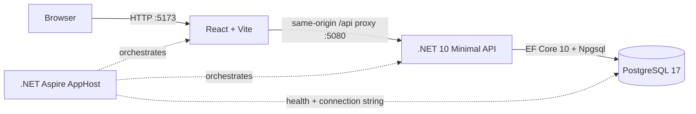

# Architecture and current status

## Runtime topology

The Aspire AppHost is the local system composition root. It starts PostgreSQL with a persistent named data volume, injects the database connection into the API, waits for PostgreSQL readiness, and starts the Vite UI after the API. The browser calls the UI at port 5173; Vite forwards `/api` and `/health` requests to port 5080.

## Technologies

| Area | Current implementation |
|---|---|
| UI | React, TypeScript, Vite |
| API | .NET 10 ASP.NET Core Minimal API |
| Persistence | EF Core 10, Npgsql EF provider, PostgreSQL 17 |
| Local orchestration | .NET Aspire 13.6.2 AppHost, PostgreSQL and JavaScript/Vite integrations |
| API contract | Budget identity plus versioned monthly snapshot |

## Implemented user path

1. The Plan screen loads the budget identity from `GET /api/budget` and the selected month from `GET /api/budget/{YYYY-MM}`.
2. The API initializes the first month with a deterministic blank starter category structure, then creates later months by carrying forward available category balances and Ready to Assign.
3. The UI lets the user browse months, edit assignments, move money, add funds, manage groups/categories, archive items, reorder them, and record a month note.
4. After a short debounce, the UI sends editable state and its version to `PUT /api/budget/{YYYY-MM}`. The API calculates available amounts and Ready to Assign and rejects stale versions with the current snapshot.
5. The API persists each monthly snapshot atomically through EF Core/PostgreSQL. Budget naming uses a separate versioned `PUT /api/budget` endpoint.

`/health` checks database connectivity. EF migrations are applied when the API starts.

## Current feature inventory

| Capability | Status |
|---|---|
| Plan screen layout and category table | Implemented; API initializes a blank starter structure |
| Month navigation and independent month records | Implemented with one-time carry-forward initialization |
| Edit assigned amount and Ready to Assign | Server-calculated and versioned |
| Move money between categories | Implemented as paired assignment changes in one monthly save |
| Add, rename, reorder, archive/restore group/category | Implemented and persisted |
| Budget identity and name | One default budget, name editable and persisted |
| Category filters, search, collapse, select, progress bars | UI interactions implemented; several options are view-only |
| Undo/redo | In-memory UI history; edits are saved but no server-side audit event is recorded |
| Month note | Persisted on the monthly snapshot |
| Accounts, transaction register, bank linking, scheduled entries | Not implemented; visible account values are mock data |
| Targets and assignment recommendations | Basic static target/progress display only |
| Reflect reports | Not implemented; entry remains a placeholder |
| Authentication, household sharing, multi-user conflict handling | Not implemented |

## Design limits to address

- `App.tsx` currently combines navigation, state, dialogs, table rendering, and data access. Split feature UI and API client code as slices grow.
- Activity is still a legacy persisted baseline, not transaction-derived. The account/transaction ledger is the next source-of-truth milestone.
- Monthly writes replace the editable snapshot and use optimistic concurrency; membership/authorization boundaries are not implemented.
- The app currently supports one default budget identity. Multiple budgets and household access are planned for Milestone 8.
- No authorization boundary protects the API. Do not connect real financial accounts or expose the API beyond the local machine until identity, tenant isolation, and security review are delivered.
