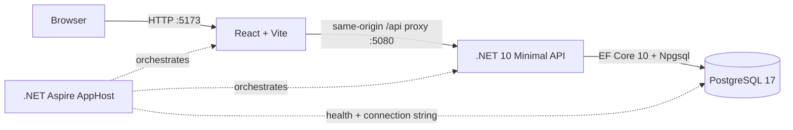

# Architecture and current status

## Runtime topology

The Aspire AppHost is the local system composition root. It starts PostgreSQL with a persistent named data volume, injects the database connection into the API, waits for PostgreSQL readiness, and starts the Vite UI after the API. The browser calls the UI at port 5173; Vite forwards `/api` and `/health` requests to port 5080.

## Technologies

| Area | Current implementation |
|---|---|
| UI | React, TypeScript, Vite |
| API | .NET 10 ASP.NET Core Minimal API |
| Persistence | EF Core 10, Npgsql EF provider, PostgreSQL 17 |
| Local orchestration | .NET Aspire 13.6.2 AppHost, PostgreSQL and JavaScript/Vite integrations |
| API contract | Budget identity plus versioned monthly snapshot |
| Authentication | ASP.NET Core Identity with cookie sessions, verified registration, password recovery and administrator role |

## Implemented user path

1. The Plan screen loads the budget identity from `GET /api/budget` and the selected month from `GET /api/budget/{YYYY-MM}`.
2. The API initializes the first month with a deterministic blank starter category structure, then creates later months by carrying forward available category balances and Ready to Assign.
3. The UI lets the user browse months, edit assignments, move money, manage groups/categories, archive/reorder them, inspect category activity and upcoming transactions, and record a month note. New income is recorded through the cash register; existing manual funds remain a read-only baseline.
4. After a short debounce, the UI sends editable state and its version to `PUT /api/budget/{YYYY-MM}`. The API calculates available amounts and Ready to Assign and rejects stale versions with the current snapshot.
5. Long-Term Planning reads existing actual month snapshots without initializing new months. Forecast income and expenses come from scheduled ledger transactions across accounts; effective-month category budget overrides use separate versioned planning tables and never change monthly Plan state.
6. The API persists monthly snapshots atomically through EF Core/PostgreSQL. Budget naming uses a separate versioned `PUT /api/budget` endpoint.

`/health` checks database connectivity. EF migrations are applied when the API starts.

## Current feature inventory

| Capability | Status |
|---|---|
| Plan screen layout and category table | Implemented; API initializes a blank starter structure |
| Month navigation and independent month records | Implemented with one-time carry-forward initialization |
| Edit assigned amount and Ready to Assign | Server-calculated and versioned |
| Move money between categories | Implemented as paired assignment changes in one monthly save |
| Add, rename, reorder, archive/restore group/category | Implemented and persisted |
| Budget identity and name | One default budget, name editable and persisted |
| Category filters, search, collapse, select, progress bars | Implemented; bars show remaining funds and uncovered overspending |
| Category activity and scheduled spending | Monthly activity opens filtered ledger rows; category details show upcoming transactions and projected availability |
| Category creation and ordering | Add categories from a group, drag groups/categories to reorder and move categories between groups; versioned monthly saves preserve category identity |
| Undo/redo | In-memory UI history; edits are saved but no server-side audit event is recorded |
| Month note | Persisted on the monthly snapshot |
| Long-Term Planning | Implemented; annual grid, separate forecast persistence, effective-month overrides, read-only actuals and cross-year carry-forward |
| Cash accounts, register, transfers, splits, reconciliation | Implemented; real ledger-backed balances, server filters/pagination and retained audit |
| Account View Options | Server-persisted per-account presets, month range and visibility switches, independently versioned |
| Scheduled register | Anchored recurrence rules, forecasts, idempotent due-day posting, approval and occurrence review |
| Bank linking, credit/debt accounts | Future milestones |
| Targets and assignment recommendations | Basic static target/progress display only |
| Reflect reports | Not implemented; entry remains a placeholder |
| Identity sign-in, bootstrap administrators, verified registration/recovery and audited account lifecycle administration | Implemented as initial Milestone 2a slices |
| Owner-scoped budget identity, archive/restore, membership limits and monthly Plan snapshots | Implemented in APIs; ledger/planning data scoping and UI budget selection remain |

## Design limits to address

- `App.tsx` currently combines navigation, state, dialogs, table rendering, and data access. Split feature UI and API client code as slices grow.
- Activity combines an explicit legacy baseline with ledger-derived activity. New cash flows come from account transactions; prototype manual funds are preserved read-only.
- Monthly writes replace the editable snapshot and use optimistic concurrency; owner checks protect budget-scoped Plan routes.
- Budget identity and monthly Plan snapshots are owner-scoped. Ledger and long-term planning tables still use the shared legacy budget; their endpoints remain administrator-only until those resources are scoped. The UI still starts with the legacy default route.
- Membership plans seed Free/Plus/Pro and enforce active-budget limits; administrators can assign tiers and per-user overrides from the admin panel.

## Cash ledger slice

The frontend ledger lives in `src/ledger/` with a typed API client, reusable accessible dialog, transaction form and account/register screen. `AccountRegister.tsx` provides the compact account header, cleared/uncleared/working balance equation, transaction rows and status indicators. The register has separate outflow/inflow/running-balance columns, green cleared circles and reconciled locks. Filters and secondary actions live under View; row selection exposes editing/deletion. Account type/favorite persist, reconciliation age comes from actual snapshots, and manual accounts show Unlinked. File import, ledger undo/redo, and scheduling remain disabled until their workflows exist. Navigation waits for pending Plan edits to save. Returning to Plan reloads server-calculated amounts. Sidebar accounts use the API; mock credit/loan balances are removed.

`LedgerService` applies domain rules and month projection; `LedgerGate` orders month initialization, Plan writes and ledger commands under a PostgreSQL row lock/transaction. The global ledger revision detects stale edits. Before/after audit receipts, transfer legs, reconciliation and month changes commit together. Register and account snapshots share the same revision. Lost-response retries reuse the original command; conflicts require reload/review.

Account balances are queried from the ledger. Projection recalculates initialized months and propagates ledger balance deltas into later opening values, preserving explicit assignments. This single-budget implementation favors explicit correctness; incremental projection is an optimization if measured scale requires it. Reconciled entries require explicit edit confirmation; snapshots are retained/inactivated and changes audited. Forecasts stay outside actual totals until their due day or explicit Enter Now; due-day entries require approval. A scoped background worker/read catch-up shares the normal application-service transaction path. Account view preferences, notes, adjustments and named flags persist on the server.

Domain unit tests, disposable-PostgreSQL HTTP integration tests and React workflow tests cover this slice. See [testing](testing.md).

The register reuses `PayeePicker` and `ManagePayees` for grouped account/merchant choices and persisted payee policies. Popovers are portals so the scrollable register does not clip them; dialogs contain Escape without closing the surrounding inline draft. In the inline editor, selector chevrons remain clickable but are skipped by Tab so focus moves directly to the next field; input focus does not add a second outline around the field. Payee dialog Undo/Redo is draft-local; committed financial history uses ledger audit/replay.

`CategoryPicker` is shared by the inline transaction's main category and split parts. `loadCategoryBudget` retains group metadata and authoritative available/Ready to Assign amounts from the transaction month; `loadCategories` remains the compatibility wrapper for other forms. The portal prevents register clipping. `NewCategoryDialog` extends the existing monthly snapshot workflow; category-list refresh does not remount the transaction draft. No backend model/endpoint or migration is added for this UI extension.

Plan activity uses the existing date/category-filtered register endpoint and includes reconciled rows. Selecting a result opens its account with the row focused and temporarily applies the account/date/reconciled filters needed to reveal it. Category details use the existing scheduled transaction endpoint; forecasts stay outside actual activity and account totals. Category/group drag changes save through the versioned month snapshot. Category identity is stable within a month while its group membership changes, so a move retains assignment, available balance and ledger links.

`BudgetCarryForward` is the shared pure domain helper for assignment and ledger opening-balance deltas. `BudgetService` snapshots source balances before changing assignments and applies their differences to all initialized later months before the single save. `LedgerService` uses the same helper while recomputing activity chronologically. Monthly API writes use the gate's commit predicate to roll back invalid/conflicting results. The Plan client retains dirty assignments through its autosave boundary and never invents carry totals.
