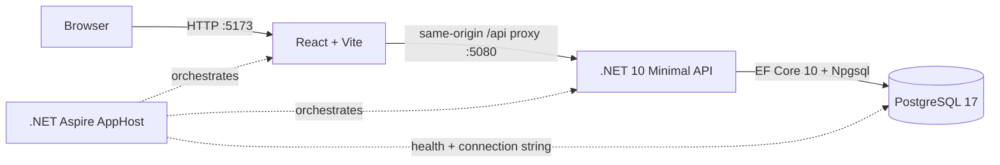

# Architecture and current status

## Runtime topology

The Aspire AppHost is the local system composition root. It starts PostgreSQL with a persistent named data volume, injects the database connection into the API, waits for PostgreSQL readiness, and starts the Vite UI after the API. The browser calls the UI at port 5173; Vite forwards `/api` and `/health` requests to port 5080.

## Technologies

| Area | Current implementation |
|---|---|
| UI | React, TypeScript, Vite |
| API | .NET 10 ASP.NET Core Minimal API |
| Persistence | EF Core 10, Npgsql EF provider, PostgreSQL 17 |
| Local orchestration | .NET Aspire 13.6.2 AppHost, PostgreSQL and JavaScript/Vite integrations |
| API contract | JSON `BudgetDto` monthly snapshot |

## Implemented user path

1. The Plan screen requests `GET /api/budget/{YYYY-MM}` when it opens or changes month.
2. The API loads the month. If it does not exist, it creates a deterministic synthetic sample budget.
3. The UI lets the user browse months, edit assigned amounts, move assignment between categories, add groups/categories, rename groups/categories, filter categories, and record a month note.
4. After a short debounce, the UI sends the whole monthly state to `PUT /api/budget/{YYYY-MM}`.
5. The API replaces that month's group/category snapshot within a database transaction.

`/health` checks database connectivity. EF migrations are applied when the API starts.

## Current feature inventory

| Capability | Status |
|---|---|
| Plan screen layout and category table | Implemented with synthetic data |
| Month navigation and independent month records | Implemented; unseen months are initialized from the same sample plan |
| Edit assigned amount | Implemented and persisted |
| Move money between categories | Implemented in the UI state and persisted as the resulting snapshot |
| Add category group/category | Implemented and persisted |
| Rename group/category | Implemented with browser prompts and persisted |
| Category filters, search, collapse, select, progress bars | UI interactions implemented; several options are view-only |
| Undo/redo | In-memory UI history; edits are saved but no server-side audit event is recorded |
| Month note | Persisted on the monthly snapshot |
| Accounts, transaction register, bank linking, scheduled entries | Not implemented; visible account values are mock data |
| Targets and assignment recommendations | Basic static target/progress display only |
| Reflect reports | Not implemented; entry remains a placeholder |
| Authentication, household sharing, multi-user conflict handling | Not implemented |

## Design limits to address

- `App.tsx` currently combines navigation, state, dialogs, table rendering, and data access. Split feature UI and API client code as slices grow.
- Assignment, activity, available, and the Ready to Assign banner are currently partly mock/calculated in the browser. A domain service must become the source of truth before adding a real ledger.
- `PUT` replaces all data for a month and has no ETag/version check. Concurrent edits can overwrite each other.
- New months currently clone the same sample plan; real month carry-forward must be explicit and preserve the account/category rules.
- No authorization boundary protects the API. Do not connect real financial accounts or expose the API beyond the local machine until identity, tenant isolation, and security review are delivered.
