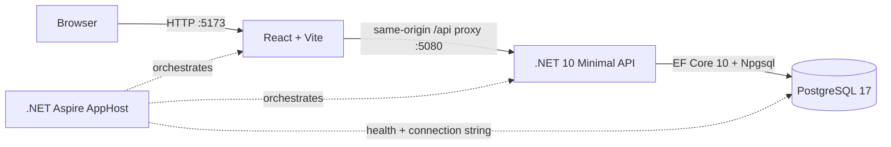

# Architecture and current status

## Runtime topology

The Aspire AppHost is the local system composition root. It starts PostgreSQL with a persistent named data volume, injects the database connection into the API, waits for PostgreSQL readiness, and starts the Vite UI after the API. The browser calls the UI at port 5173; Vite forwards `/api` and `/health` requests to port 5080.

## Technologies

| Area | Current implementation |
|---|---|
| UI | React, TypeScript, Vite |
| API | .NET 10 ASP.NET Core Minimal API |
| Persistence | EF Core 10, Npgsql EF provider, PostgreSQL 17 |
| Local orchestration | .NET Aspire 13.6.2 AppHost, PostgreSQL and JavaScript/Vite integrations |
| API contract | Budget identity plus versioned monthly snapshot |
| Authentication | ASP.NET Core Identity with cookie sessions, verified registration, branded SMTP email, password recovery and administrator role |

## Implemented user path

1. The Plan screen loads the budget identity from `GET /api/budget` and the selected month from `GET /api/budget/{YYYY-MM}`.
2. The API initializes the first month with a deterministic blank starter category structure, then creates later months by carrying forward available category balances and Ready to Assign.
3. The UI lets the user browse months, edit assignments, move money, manage groups/categories, archive/reorder them, inspect category activity and upcoming transactions, and record a month note. A non-zero category Available amount opens the move-money dialog: positive balances move from the clicked category, while negative balances open a cover-overspending flow from a funded category; zero Available amounts remain non-interactive. New income is recorded through the cash register; existing manual funds remain a read-only baseline.
4. After a short debounce, the UI sends editable state and its version to `PUT /api/budget/{YYYY-MM}`. The API calculates available amounts and Ready to Assign and rejects stale versions with the current snapshot.
5. Long-Term Planning reads existing actual month snapshots without initializing new months. Forecast income and expenses come from scheduled ledger transactions across accounts; effective-month category budget overrides use separate versioned planning tables and never change monthly Plan state.
6. The API persists monthly snapshots atomically through EF Core/PostgreSQL. Budget naming uses a separate versioned `PUT /api/budget` endpoint.

`/health` checks database connectivity. EF migrations are applied when the API starts.

## Current feature inventory

| Capability | Status |
|---|---|
| Plan screen layout and category table | Implemented; API initializes a blank starter structure |
| Month navigation and independent month records | Implemented with one-time carry-forward initialization |
| Edit assigned amount and Ready to Assign | Server-calculated and versioned |
| Move money between categories | Implemented as paired assignment changes in one monthly save |
| Add, rename, reorder, archive/restore group/category | Implemented and persisted; clicking a group name opens its name popover, while a subcategory must first be selected before its name opens the same editor. Saved history is archived rather than deleted. |
| Budget identity and name | One default budget, name editable and persisted |
| Budget Together and Recent Moves | Implemented with owner-managed email invitations, shared editor access across Plan/ledger data, automatic verified-email invitation claiming, member removal, and immutable actor-attributed Plan assignment/move history. The logo menu opens the member screen; the Plan toolbar opens the filterable history panel. |
| Category filters, search, collapse, select, progress bars | Implemented; bars show available funds in green, posted spending as an empty green-outlined segment, actual overspending in red, and only the uncovered portion of selected-month scheduled outflows in orange. A scheduled outflow that leaves Available at zero or above remains green; a partially funded one splits into green covered and orange uncovered portions. Hiding bars uses a denser category-table row layout. |
| Category activity and scheduled spending | Monthly activity opens filtered ledger rows; selecting a category shows its selected-month upcoming transactions and projected availability in the right column. The upcoming summary opens a transaction list. Available is highlighted only when selected-month scheduled outflows would make it negative; a projected zero is not a shortfall. A compact orange marker appears beside an affected subcategory's checkbox, and a collapsed group shows a warning triangle when any contained subcategory has that projected shortfall. Subcategory rows retain the normal pointer while remaining draggable; hovering Assigned reveals its bordered editor affordance and adjustment icon. Clicking an unselected category row's background or Assigned amount selects only that category and opens Assigned for editing; clicking its selected row background deselects it. Checkboxes support multi-selection. |
| Category creation and ordering | Add categories from a group; drag groups to reorder and drag subcategories before or after another subcategory within or across groups. Dropping on a group appends it; versioned monthly saves preserve category identity. |
| Undo/redo | In-memory UI history; edits are saved but no server-side audit event is recorded |
| Month note | Persisted on the monthly snapshot |
| Long-Term Planning | Implemented; annual grid with click-to-edit planned Assigned amounts, separate forecast persistence, effective-month overrides, read-only actuals and cross-year carry-forward |
| Cash accounts, register, transfers, splits, reconciliation | Implemented; real ledger-backed balances, server filters/pagination and retained audit |
| Account View Options | Server-persisted per-account presets, month range and visibility switches, independently versioned |
| Scheduled register | Anchored recurrence rules, forecasts, idempotent due-day posting, approval and occurrence review |
| Credit accounts | Implemented: Credit Card and Line of Credit types, a CREDIT sidebar section, required categories on card transactions, an automatic Credit Card Payments group a payment details panel and debt payoff targets (Pay Off Balance by Date / Pay Specific Amount Monthly) with server-calculated monthly progress. Loans and the payoff planner remain planned. |
| Wishlist | Implemented: entitlement-gated (`wishlist`, Plus/Pro by default), per-budget enable/disable, ranked buckets and items with drag/keyboard ordering, a server-owned Wishlist Plan group with one category per bucket, server-calculated next-item progress on the Wishlist screen and Plan rows, ready-to-buy nav badge and purchase/removal history. See [Milestone 13](milestones/milestone-13-wishlist.md). |
| Bank linking, loan accounts | Future milestones |
| Targets and assignment recommendations | Category targets (Weekly, Monthly, Yearly, Custom with optional repeat; set aside or refill/fill up) are stored per budget and logical category with their own version and command receipts; the server calculates each month's needed/more-needed amount, bar segments and funded fraction on the month DTO. Auto-Assign Underfunded assigns the larger of a category's target need and its current-month scheduled-outflow shortfall; with no category selection it covers all active subcategories, otherwise only selected subcategories. Other actions use last month and trailing 12-month actual assignments/spending; manual assignment and reset actions use the existing versioned Plan save. Target pause/snooze, templates and preview/apply workflows remain planned. |
| Reflect reports | Not implemented; entry remains a placeholder |
| Identity sign-in, bootstrap administrators, verified registration/recovery, admin-managed encrypted SMTP settings and audited account lifecycle administration | Implemented |
| Owner-scoped budget identity, archive/restore, membership limits, monthly Plan snapshots, ledger/planning isolation and active budget selection | Implemented |

The sidebar budget header highlights on hover and shows the signed-in email under the active budget name. Clicking it opens a menu with New Plan (create budget), plan/account entries, administrator-only Admin navigation, and Sign Out. Hovering Open Plan fades in an adjacent Recent Plans panel with a View All Plans option; it fades out when the pointer leaves both the item and panel. Selecting a budget switches the active budget. Rename, archive, delete, and restore controls are not exposed in this sidebar menu.
The sidebar groups open and closed accounts under CASH and, when any exist, CREDIT; each heading shows its total and collapses independently. Credit rows show a card icon. Add Account first opens Select Account Type (Cash Accounts: Checking, Savings, Cash; Credit Accounts: Credit Card, Line of Credit) and then the account form; credit accounts ask for the balance owed.
Selecting a credit payment category in Plan shows its Payment card (funded/underfunded status, amount still to assign, Total Underfunded) and Current Balance breakdown from `GET /api/accounts/{id}/credit-summary/{month}`. The payment group cannot be renamed, dragged or extended. "Create a Debt Payoff Target" opens a Target editor (type popover, month/year selects that disable past months, or a monthly amount); a saved target replaces the Payment card with a progress ring, an assign-this-month banner and Needed/Available/To Go rows from `GET /api/accounts/{id}/payoff-target/{month}`. Saves and deletes are ledger commands that keep the command ID for lost-response retries and ask for a reload on version conflicts.
The CASH account heading matches the navigation items' 228px width and 40px height. It toggles its account rows while keeping the total visible. Its chevron points down when expanded and right when collapsed.
An Add Account button follows the CASH account list outside its collapsible content, so it remains visible when CASH is collapsed. It opens the existing account form on the Accounts page.
If the loaded account list is empty, the sidebar shows a No Accounts message with Open Budget wording in place of CASH, followed by the Add Account button. Loading and failed account requests do not show the empty message.
On desktop, the sidebar edge can be dragged between 190px and 420px. Its footer control collapses it to a 56px icon rail and expands it back to the saved width; both settings are stored locally. The existing mobile drawer remains full width.

## Wishlist slice

Wishlist UI lives in `src/OpenBudget.UI/src/wishlist/` (typed client, sidebar nav item/hook, page, Plan row status and category card). `App.tsx` only mounts the nav item below Long-Term Planning, routes the `Wishlist` page, renders `wishlistProgress` on Plan rows/details, and disables rename/archive/reorder/drag/add for the `wishlist` group. The API keeps the feature in `Wishlist*.cs`: `WishlistRules` (validation, progress, Plan structure sync and Plan-save guard), `WishlistService` (endpoints under `/api/budgets/{id}/wishlist`, each with `RequireEntitlement("wishlist")`, owner/editor access and `LedgerGate`), and `WishlistModel` (EF configuration and entitlement seed). `BudgetService.UpdateMonthAsync` calls the Plan-save guard and `ToDtoAsync` attaches progress. The admin panel lists feature keys with tier checkboxes and per-user overrides.

## Design limits to address

- `App.tsx` currently combines navigation, state, dialogs, table rendering, and data access. Split feature UI and API client code as slices grow.
- Activity combines an explicit legacy baseline with ledger-derived activity. New cash flows come from account transactions; prototype manual funds are preserved read-only.
- Monthly writes replace the editable snapshot and use optimistic concurrency; owner checks protect budget-scoped Plan routes.
- Budget identity, monthly Plan snapshots, ledger resources and long-term planning are owner-scoped to the active budget. The UI persists selection locally and sends a budget cookie that the API validates against the authenticated owner. Legacy default budget routes remain administrator-only.
- Membership plans seed Free/Plus/Pro and enforce active-budget limits; administrators can assign tiers and per-user overrides from the admin panel.

## Cash ledger slice

The frontend ledger lives in `src/ledger/` with a typed API client, reusable accessible dialog, transaction form and account/register screen. `AccountRegister.tsx` provides the compact account header, cleared/uncleared/working balance equation, transaction rows and status indicators. The register has separate outflow/inflow/running-balance columns, green cleared circles and reconciled locks. Split transactions expand into indented category and amount detail rows controlled by an accessible disclosure chevron; double-clicking any detail row opens its parent transaction for editing. Inline split editing aligns each part's payee, category, memo, outflow and inflow with the register columns and shows the remaining amount to assign. Split descriptions persist with their category allocation. Filters and secondary actions live under View; row selection exposes editing/deletion. Account type/favorite persist, reconciliation age comes from actual snapshots, and manual accounts show Unlinked. File import, ledger undo/redo, and scheduling remain disabled until their workflows exist. Navigation waits for pending Plan edits to save. Returning to Plan reloads server-calculated amounts. Sidebar accounts use the API; mock credit/loan balances are removed.
The Scheduled Transactions disclosure appears only when the current account's schedule query has results. It uses a right-pointing chevron when collapsed and a downward chevron when expanded. Its expanded/collapsed state is saved with the budget/account's server-persisted register view options and restored when revisiting it. Every visible register column except the last can be resized from its right header edge. Dragging trades width only with the column to its right (both keep at least 24px), so the table total and all other columns stay unchanged; widths are saved with that account's server-persisted register view options and restored when revisiting it.

`LedgerService` applies domain rules and month projection; `LedgerGate` orders month initialization, Plan writes and ledger commands under a PostgreSQL row lock/transaction. The global ledger revision detects stale edits. Before/after audit receipts, transfer legs, reconciliation and month changes commit together. Register and account snapshots share the same revision. Lost-response retries reuse the original command; conflicts require reload/review.

Account balances are queried from the active budget's ledger. Projection recalculates initialized months and propagates ledger balance deltas into later opening values, preserving explicit assignments. The budget-specific database gate favors explicit correctness; incremental projection is an optimization if measured scale requires it. Reconciled entries require explicit edit confirmation; snapshots are retained/inactivated and changes audited. Forecasts stay outside actual totals until their due day or explicit Enter Now; due-day entries require approval. A scoped background worker/read catch-up shares the normal application-service transaction path. Account view preferences, notes, adjustments and named flags persist on the server within each budget.

Domain unit tests, disposable-PostgreSQL HTTP integration tests and React workflow tests cover this slice. See [testing](testing.md).

The register reuses `PayeePicker` and `ManagePayees` for grouped account/merchant choices and persisted payee policies, including payees on split entries (where transfer choices are unavailable). Popovers are portals so the scrollable register does not clip them; dialogs contain Escape without closing the surrounding inline draft. In the inline editor, selector chevrons and calendar controls remain clickable but are skipped by Tab, so Tab moves Date → Payee → Category → Memo. Payee and category lists open when their field gains focus, and choosing a calendar day, payee or category moves focus to the next field. Choosing Ready to Assign shows "Inflow: Ready to Assign" and saves no category; input focus does not add a second outline around the field. Payee dialog Undo/Redo is draft-local; committed financial history uses ledger audit/replay.

`CategoryPicker` is shared by transaction categories, split parts, payee defaults and Plan move/cover flows. It renders category-group sections, indented subcategories, and authoritative available/Ready to Assign amounts. `loadCategoryBudget` retains group metadata and authoritative available/Ready to Assign amounts from the transaction month; `loadCategories` remains the compatibility wrapper for other forms. The portal prevents register clipping. `NewCategoryDialog` extends the existing monthly snapshot workflow; category-list refresh does not remount the transaction draft. Split payee and memo are persisted by the ledger service and the `TransactionSplitDetails` migration.

Plan activity uses the existing date/category-filtered register endpoint and includes reconciled rows. Split transactions expand into their category-specific subtransaction entries in Plan and Long-Term Planning activity lists. Selecting a split entry opens its account register, reveals and highlights that split row, and temporarily applies the account/date/reconciled filters needed to reveal its parent transaction. Category details use the existing scheduled transaction endpoint; forecasts stay outside actual activity and account totals. Category/group drag changes save through the versioned month snapshot. Category identity is stable within a month while its group membership changes, so a move retains assignment, available balance and ledger links.

`BudgetCarryForward` is the shared pure domain helper for assignment and ledger opening-balance deltas. Positive Available carries into the same category; uncovered negative Available resets to zero at rollover and reduces the following month's Ready to Assign. `BudgetService` snapshots source balances before changing assignments and recalculates initialized later months chronologically before the single save. `LedgerService` uses the same helper while recomputing activity chronologically. Monthly API writes use the gate's commit predicate to roll back invalid/conflicting results. The Plan client retains dirty assignments through its autosave boundary and never invents carry totals.

Every money field (Plan Assigned and move/assign amounts, transaction outflow/inflow/split amounts, account opening/working/statement balances, transfer amounts, Long-Term Planning Assigned and payoff monthly amount) accepts arithmetic with `+ - * /` and parentheses, for example `12.50+7.25`. `moneyExpression.ts` evaluates it without `eval`, allows at most two decimals per number, and rounds the result to cents. The shared `MoneyInput` shows the Plan Assigned calculator icon and replaces the expression with its result on blur or Enter; the existing parsers also evaluate expressions, so the API still receives plain decimal amounts.

## Category targets

Selecting a regular category in Plan adds a collapsible **Target** card under its details (never for credit card payment categories, which keep their debt payoff target). Without a target it asks "How much do you need for ...?" and offers **Create Target**. The editor (`CategoryTarget.tsx`) has Weekly / Monthly / Yearly / Custom tabs: Weekly takes an amount and weekday; Monthly an amount, a "By" day (Last Day of Month or 1st-31st) and a "Next month I want to" popover (Set aside another / Refill up to); Yearly an amount, a dd-MM-yyyy date with a calendar (`TargetDateField.tsx`) and "Next year I want to"; Custom an amount, "I want to" (Set aside another / Fill up to), "Due on" and a Repeat switch revealing Every [1-99] [Day/Week/Month/Year]. Delete (only for a saved target), Cancel and Save Target finish the editor. A saved target shows a progress ring, "EUR X more needed this month", Needed/Assigned/Due/To Go rows and **Edit Target**. Writes keep their command for lost-response retries (same command ID) and a `409` offers **Reload target**; results patch the loaded month without a Plan save.

`CategoryTargetService` owns validation, access, versioning and receipts; `CategoryTargetRules` is the pure calculation used by `BudgetService.ToDtoAsync`, so Plan rows render from the month response without extra calls. Rows with an active target show "EUR X more needed this month" above a bar split into `segments` equal parts (one per weekday occurrence for weekly targets) that fill yellow while underfunded and green when funded, and the Available pill turns yellow with a small progress-ring icon while money is still needed.
