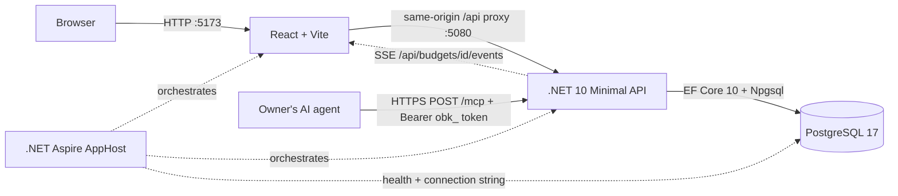

# Architecture and current status

## Runtime topology

The Aspire AppHost is the local system composition root. It starts PostgreSQL with a persistent named data volume, injects the database connection into the API, waits for PostgreSQL readiness, and starts the Vite UI after the API. The browser calls the UI at port 5173; Vite forwards `/api`, `/health` and `/mcp` requests to port 5080 and serves `index.html` for every other path so client-side routes (see [URL routing](#url-routing)) survive a refresh.

## Technologies

| Area | Current implementation |
|---|---|
| UI | React, TypeScript, Vite |
| API | .NET 10 ASP.NET Core Minimal API |
| Persistence | EF Core 10, Npgsql EF provider, PostgreSQL 17 |
| Local orchestration | .NET Aspire 13.6.2 AppHost, PostgreSQL and JavaScript/Vite integrations |
| API contract | Budget identity plus versioned monthly snapshot |
| Authentication | ASP.NET Core Identity with cookie sessions, verified registration, branded SMTP email, password recovery and administrator role; hashed personal agent tokens (bearer) for the MCP endpoint only |
| Agent integration | MCP server via `ModelContextProtocol.AspNetCore` 2.2.0 (Streamable HTTP, stateless) hosted in the API process |
| Real-time updates | In-process change hub fed by an EF Core commit interceptor; server-sent events to the browser |

## Implemented user path

1. The Plan screen loads the budget identity from `GET /api/budget` and the selected month from `GET /api/budget/{YYYY-MM}`.
2. The API initializes the first month with a deterministic blank starter category structure, then creates later months by carrying forward available category balances and Ready to Assign.
3. The UI lets the user browse months, edit assignments, move money, manage groups/categories, archive/reorder them, inspect category activity and upcoming transactions, and record a month note. A non-zero category Available amount opens the move-money dialog: positive balances move from the clicked category, while negative balances open a cover-overspending flow from a funded category; zero Available amounts remain non-interactive. New income is recorded through the cash register; existing manual funds remain a read-only baseline.
4. After a short debounce, the UI sends editable state and its version to `PUT /api/budget/{YYYY-MM}`. The API calculates available amounts and Ready to Assign and rejects stale versions with the current snapshot.
5. Long-Term Planning reads existing actual month snapshots without initializing new months. Forecast income and expenses come from scheduled ledger transactions across accounts; effective-month category budget overrides use separate versioned planning tables and never change monthly Plan state. Month DTOs expose each category's effective override as read-only `planned` (`LongTermPlanningPlanValues`); the Plan shows it as muted text under Assigned (category rows and group sums, progress and compact layouts, hidden while editing) and Auto-Assign offers a **Planned** option that tops categories up to it through the normal versioned save, undo/redo and Recent Moves path.
6. The API persists monthly snapshots atomically through EF Core/PostgreSQL. Budget naming uses a separate versioned `PUT /api/budget` endpoint.

`/health` checks database connectivity. EF migrations are applied when the API starts.

## Current feature inventory

| Capability | Status |
|---|---|
| Plan screen layout and category table | Implemented; API initializes a blank starter structure |
| Month navigation and independent month records | Implemented with one-time carry-forward initialization |
| Edit assigned amount and Ready to Assign | Server-calculated and versioned |
| Move money between categories | Implemented as paired assignment changes in one monthly save |
| Add, rename, reorder, archive/restore group/category | Implemented and persisted; clicking a group name opens its name popover, while a subcategory must first be selected before its name opens the same editor. Saved history is archived rather than deleted. |
| Budget identity and name | One default budget, name editable and persisted |
| Budget Together and Recent Moves | Implemented with owner-managed email invitations, shared editor access across Plan/ledger data, automatic verified-email invitation claiming, member removal, and immutable actor-attributed Plan assignment/move history. The logo menu opens the member screen; the Plan toolbar opens the filterable history panel. |
| Category filters, search, collapse, select, progress bars | Implemented; bars show available funds in green, posted spending as an empty green-outlined segment, actual overspending in red, and only the uncovered portion of selected-month scheduled outflows in orange. A scheduled outflow that leaves Available at zero or above remains green; a partially funded one splits into green covered and orange uncovered portions. Hiding bars uses a denser category-table row layout. |
| Category activity and scheduled spending | Monthly activity opens filtered ledger rows; selecting a category shows its selected-month upcoming transactions and projected availability in the right column. The upcoming summary opens the same transaction popup. Every transaction-list popup (Plan activity and upcoming, Long-Term activity, credit payment category activity) uses the single `PlanTransactionList` component: a popover anchored under the clicked amount with an Activity title, a context subtitle (category name, or `Combination (…)` for groups), ACCOUNT/DATE/PAYEE/MEMO/AMOUNT columns, Escape/outside-click/Close dismissal and focus return. Its `credit` variant, used for payment categories, adds a Spending/Returns/Funded Spending/Payments & Returns summary box (see [credit card activity](credit-card-activity.md)) and DATE/PAYEE/CATEGORY/MEMO/AMOUNT columns over a scrolling table body. Available is highlighted only when selected-month scheduled outflows would make it negative; a projected zero is not a shortfall. A compact orange marker appears beside an affected subcategory's checkbox, and a collapsed group shows a warning triangle when any contained subcategory has that projected shortfall. Subcategory rows retain the normal pointer while remaining draggable; hovering Assigned reveals its bordered editor affordance and adjustment icon. Clicking an unselected category row's background or Assigned amount selects only that category and opens Assigned for editing; clicking its selected row background deselects it. Checkboxes support multi-selection. |
| Category creation and ordering | Add categories from a group; drag groups to reorder and drag subcategories before or after another subcategory within or across groups. Dropping on a group appends it; versioned monthly saves preserve category identity. |
| Undo/redo | In-memory UI history; edits are saved but no server-side audit event is recorded |
| Month note | Persisted on the monthly snapshot |
| Long-Term Planning (labelled "Long-Term" in the navigation and page heading) | Implemented; annual grid with click-to-edit planned Assigned amounts, separate forecast persistence, effective-month overrides, read-only actuals and cross-year carry-forward |
| Cash accounts, register, transfers, splits, reconciliation | Implemented; real ledger-backed balances, server filters/pagination and retained audit |
| Account View Options | Server-persisted per-account presets, month range and visibility switches, independently versioned |
| Scheduled register | Anchored recurrence rules, forecasts, idempotent due-day posting, approval and occurrence review |
| Credit accounts | Implemented: Credit Card and Line of Credit types, a CREDIT sidebar section, required categories on card transactions, an automatic Credit Card Payments group a payment details panel and debt payoff targets (Pay Off Balance by Date / Pay Specific Amount Monthly) with server-calculated monthly progress. Loans and the payoff planner remain planned. |
| Wishlist | Implemented: entitlement-gated (`wishlist`, Plus/Pro by default), per-budget enable/disable, ranked buckets and items with drag/keyboard ordering, a server-owned Wishlist Plan group with one category per bucket, server-calculated next-item progress on the Wishlist screen and Plan rows, ready-to-buy nav badge and purchase/removal history. See [Milestone 13](milestones/milestone-13-wishlist.md). |
| Mortgages, loans and contracts | Implemented: seven loan types in a Mortgages and Loans picker section, an "Add Unlinked Account" form, a LOANS sidebar section, versioned `LoanTerms`, an optional "Pair a Category" step (existing category or a new category/group created atomically with the account; separate contract/device categories for contracts with a device), a loan account page (stats, SVG progress chart, paired category, monthly activity with estimated interest), Update Balance, a read-only payoff simulator and contract schedules. |
| Bank linking | Future milestones |
| Targets and assignment recommendations | Category targets (Weekly, Monthly, Yearly, Custom with optional repeat; set aside or refill/fill up) are stored per budget and logical category with their own version and command receipts; the server calculates each month's needed/more-needed amount, bar segments and funded fraction on the month DTO. Auto-Assign Underfunded assigns the larger of a category's target need and its current-month scheduled-outflow shortfall; with no category selection it covers all active subcategories, otherwise only selected subcategories. Other actions use last month and trailing 12-month actual assignments/spending; manual assignment and reset actions use the existing versioned Plan save. Target pause/snooze, templates and preview/apply workflows remain planned. |
| Reflect reports | Not implemented; entry remains a placeholder |
| Identity sign-in, bootstrap administrators, verified registration/recovery, admin-managed encrypted SMTP settings and audited account lifecycle administration | Implemented |
| Owner-scoped budget identity, archive/restore, membership limits, monthly Plan snapshots, ledger/planning isolation and active budget selection | Implemented |

The sidebar budget header highlights on hover and shows the signed-in email under the active budget name. Clicking it opens a menu with New Plan (create budget), plan/account entries, administrator-only Admin navigation, and Sign Out. Hovering Open Plan fades in an adjacent Recent Plans panel with a View All Plans option; it fades out when the pointer leaves both the item and panel. Selecting a budget switches the active budget. Rename, archive, delete, and restore controls are not exposed in this sidebar menu.
The sidebar groups open and closed accounts under CASH and, when any exist, CREDIT; each heading shows its total and collapses independently. Credit rows show a card icon. Add Account first opens Select Account Type (Cash Accounts: Checking, Savings, Cash; Credit Accounts: Credit Card, Line of Credit) and then the account form; credit accounts ask for the balance owed.
Selecting a credit payment category in Plan shows its Payment card (funded/underfunded status, amount still to assign, Total Underfunded) and Current Balance breakdown from `GET /api/accounts/{id}/credit-summary/{month}`. The payment group cannot be renamed, dragged or extended. "Create a Debt Payoff Target" opens a Target editor (type popover, month/year selects that disable past months, or a monthly amount); a saved target replaces the Payment card with a progress ring, an assign-this-month banner and Needed/Available/To Go rows from `GET /api/accounts/{id}/payoff-target/{month}`. Saves and deletes are ledger commands that keep the command ID for lost-response retries and ask for a reload on version conflicts.
The CASH account heading matches the navigation items' 228px width and 40px height. It toggles its account rows while keeping the total visible. Its chevron points down when expanded and right when collapsed.
An Add Account button follows the CASH account list outside its collapsible content, so it remains visible when CASH is collapsed. It opens the existing account form on the Accounts page.
If the loaded account list is empty, the sidebar shows a No Accounts message with Open Budget wording in place of CASH, followed by the Add Account button. Loading and failed account requests do not show the empty message.
On desktop, the sidebar edge can be dragged between 190px and 420px. Its footer control collapses it to a 56px icon rail and expands it back to the saved width; both settings are stored locally. The existing mobile drawer remains full width.

## Wishlist slice

Wishlist UI lives in `src/OpenBudget.UI/src/wishlist/` (typed client, sidebar nav item/hook, `WishlistPage` shell, `BucketTabs` tab strip with inline create/rename, `BucketPanel` tab panel with Plan-style item rows and history, Plan row status and category card). The selected bucket tab is kept in `localStorage` per budget; the item rows share the `--subcat-*` design tokens declared on `:root` in `styles.css` with Plan's subcategory rows. `App.tsx` only mounts the nav item below Long-Term Planning, routes the `Wishlist` page, renders `wishlistProgress` on Plan rows/details, and disables rename/archive/reorder/drag/add for the `wishlist` group. The API keeps the feature in `Wishlist*.cs`: `WishlistRules` (validation, progress, Plan structure sync and Plan-save guard), `WishlistService` (endpoints under `/api/budgets/{id}/wishlist`, each with `RequireEntitlement("wishlist")`, owner/editor access and `LedgerGate`), and `WishlistModel` (EF configuration and entitlement seed). `BudgetService.UpdateMonthAsync` calls the Plan-save guard and `ToDtoAsync` attaches progress. Record purchase lives in `WishlistPurchases.cs`: `WishlistPurchaseRules` (purchase validation, restore position), a `LedgerService` partial that runs inside `SaveTransactionAsync`/`ExecuteAsync` (one ledger command marks the item purchased and links the transaction; every ledger command restores items whose purchase transaction it soft-deleted or moved out of the bucket category, per `WishlistPurchaseRules.KeepsLink`), and the `purchase-transaction` endpoint. In the UI, `ledger/WishlistPurchase.tsx` holds the reusable `WishlistLinkButton` (icon button beside Memo with a grouped, keyboard-operable item listbox) and the memo/category fill used by `InlineTransactionEditor` and `TransactionForm`; `App.tsx` passes the entitled+enabled overview to `AccountsPage` and turns the Wishlist page's Record purchase into an add-transaction dialog with the item linked. The admin panel lists feature keys with tier checkboxes and per-user overrides.

The sidebar adds a LOANS section after CREDIT when loan or contract accounts exist (negative total in red, collapsible). Selecting a loan account replaces the register with `LoanAccountPage`: header meta ("Mortgage", "Updated never/<date>" from the last balance confirmation), edit pencil, Update Balance (Yes confirms, No records a corrected balance as an adjustment) and Add Activity (a payment transfer preset from a cash account, or an uncategorized interest/fee/correction entry); a stats row; a dismissible simulator banner (dismissal stored per browser); "Your Loan's Progress" with an inline-SVG chart (past month-end balances solid with area fill, current track dashed, hover tooltip) and the minimum-payment payoff sentence; the Paired Plan Category card ("Create Debt Payment Target" navigates to Plan with that category selected and its target editor open); and month cards (newest first, current month expanded, earlier years behind a year divider) listing payments and the estimated interest. "Share Your Progress" is shown disabled because sharing is outside this local workspace. Contracts show remaining device/contract cost, months remaining, end date, total cost and a schedule table with discounted months highlighted instead of the simulator. Add Unlinked Account's **Next** opens the shared `PairCategoryStep` (`Optional: Pair a Category`, back arrow returns to the form with its values): radio choice between **Select an existing category** (a grouped picker in plan order; Credit Card Payments, Wishlist and archived rows hidden; categories paired with another loan, from `GET /api/loan-pairings`, disabled) and **Create a new category** (name prefilled with the nickname, a group list whose first option **New Category Group** reveals a group-name input). Contracts with a device first choose one category for both or separate Contract and Device sections. **Skip** creates the account unpaired and **Next** sends the account and pairing as one create command. Edit Account reuses the step from **Pair Category** / **Change Pairing** (its secondary button is Cancel), keeps **Unpair** (per slot for contracts), and saves the change with the account update. The loan page's Paired Plan Category card shows one row per paired slot (Available to spend and Create Debt Payment Target for each). `LoanService` (a `LedgerService` part) and `LoanRules` hold the server logic; all money is decimal and server-calculated.

## Design limits to address

- `App.tsx` currently combines navigation, state, dialogs, table rendering, and data access. Split feature UI and API client code as slices grow.
- Activity combines an explicit legacy baseline with ledger-derived activity. New cash flows come from account transactions; prototype manual funds are preserved read-only.
- Monthly writes replace the editable snapshot and use optimistic concurrency; owner checks protect budget-scoped Plan routes.
- Budget identity, monthly Plan snapshots, ledger resources and long-term planning are owner-scoped to the active budget. The UI persists selection locally and sends a budget cookie that the API validates against the authenticated owner. Legacy default budget routes remain administrator-only.
- Membership plans seed Free/Plus/Pro and enforce active-budget limits; administrators can assign tiers and per-user overrides from the admin panel.

## Cash ledger slice

The frontend ledger lives in `src/ledger/` with a typed API client, reusable accessible dialog, transaction form and account/register screen. `AccountRegister.tsx` provides the compact account header, cleared/uncleared/working balance equation, transaction rows and status indicators. The register has separate outflow/inflow/running-balance columns, green cleared circles and reconciled locks. Split transactions expand into indented category and amount detail rows controlled by an accessible disclosure chevron; double-clicking any detail row opens its parent transaction for editing. Inline split editing aligns each part's payee, category, memo, outflow and inflow with the register columns and shows the remaining amount to assign. Split descriptions persist with their category allocation. Filters and secondary actions live under View; row selection exposes editing/deletion. Account type/favorite persist, reconciliation age comes from actual snapshots, and manual accounts show Unlinked. File import, ledger undo/redo, and scheduling remain disabled until their workflows exist. Navigation waits for pending Plan edits to save. Returning to Plan reloads server-calculated amounts. Sidebar accounts use the API; mock credit/loan balances are removed.
The Scheduled Transactions disclosure appears only when the current account's schedule query has results. It uses a right-pointing chevron when collapsed and a downward chevron when expanded. Its expanded/collapsed state is saved with the budget/account's server-persisted register view options and restored when revisiting it. Every visible register column except the last can be resized from its right header edge. Dragging trades width only with the column to its right (both keep at least 24px), so the table total and all other columns stay unchanged; widths are saved with that account's server-persisted register view options and restored when revisiting it.

`LedgerService` applies domain rules and month projection; `LedgerGate` orders month initialization, Plan writes and ledger commands under a PostgreSQL row lock/transaction. The global ledger revision detects stale edits. Before/after audit receipts, transfer legs, reconciliation and month changes commit together. Register and account snapshots share the same revision. Lost-response retries reuse the original command; conflicts require reload/review.

Account balances are queried from the active budget's ledger. Projection recalculates initialized months and propagates ledger balance deltas into later opening values, preserving explicit assignments. The budget-specific database gate favors explicit correctness; incremental projection is an optimization if measured scale requires it. Reconciled entries require explicit edit confirmation; snapshots are retained/inactivated and changes audited. Forecasts stay outside actual totals until their due day or explicit Enter Now; due-day entries require approval. A scoped background worker/read catch-up shares the normal application-service transaction path. Account view preferences, notes, adjustments and named flags persist on the server within each budget.

Domain unit tests, disposable-PostgreSQL HTTP integration tests and React workflow tests cover this slice. See [testing](testing.md).

The register reuses `PayeePicker` and `ManagePayees` for grouped account/merchant choices and persisted payee policies, including payees on split entries (where transfer choices are unavailable). Popovers are portals so the scrollable register does not clip them; dialogs contain Escape without closing the surrounding inline draft. In the inline editor, selector chevrons and calendar controls remain clickable but are skipped by Tab, so Tab moves Date → Payee → Category → Memo. Payee and category lists open when their field gains focus, and choosing a calendar day, payee or category moves focus to the next field. Choosing Ready to Assign shows "Inflow: Ready to Assign" and saves no category; input focus does not add a second outline around the field. Payee dialog Undo/Redo is draft-local; committed financial history uses ledger audit/replay.

`CategoryPicker` is shared by transaction categories, split parts, payee defaults and Plan move/cover flows. It renders category-group sections, indented subcategories, and authoritative available/Ready to Assign amounts. `loadCategoryBudget` retains group metadata and authoritative available/Ready to Assign amounts from the transaction month; `loadCategories` remains the compatibility wrapper for other forms. The portal prevents register clipping. `NewCategoryDialog` extends the existing monthly snapshot workflow; category-list refresh does not remount the transaction draft. Split payee and memo are persisted by the ledger service and the `TransactionSplitDetails` migration.

Plan activity uses the existing date/category-filtered register endpoint and includes reconciled rows. Split transactions expand into their category-specific subtransaction entries in Plan and Long-Term Planning activity lists. Selecting a split entry opens its account register, reveals and highlights that split row, and temporarily applies the account/date/reconciled filters needed to reveal its parent transaction. Category details use the existing scheduled transaction endpoint; forecasts stay outside actual activity and account totals. Category/group drag changes save through the versioned month snapshot. Category identity is stable within a month while its group membership changes, so a move retains assignment, available balance and ledger links.

`BudgetCarryForward` is the shared pure domain helper for assignment and ledger opening-balance deltas. Positive Available carries into the same category; uncovered negative Available resets to zero at rollover and reduces the following month's Ready to Assign. `BudgetService` snapshots source balances before changing assignments and recalculates initialized later months chronologically before the single save. `LedgerService` uses the same helper while recomputing activity chronologically. Monthly API writes use the gate's commit predicate to roll back invalid/conflicting results. The Plan client retains dirty assignments through its autosave boundary and never invents carry totals.

Every money field (Plan Assigned and move/assign amounts, transaction outflow/inflow/split amounts, account opening/working/statement balances, transfer amounts, Long-Term Planning Assigned and payoff monthly amount) accepts arithmetic with `+ - * /` and parentheses, for example `12.50+7.25`. `moneyExpression.ts` evaluates it without `eval`, allows at most two decimals per number, and rounds the result to cents. The shared `MoneyInput` shows the Plan Assigned calculator icon and replaces the expression with its result on blur or Enter; the existing parsers also evaluate expressions, so the API still receives plain decimal amounts.

## Category targets

Selecting a regular category in Plan adds a collapsible **Target** card under its details (never for credit card payment categories, which keep their debt payoff target). Without a target it asks "How much do you need for ...?" and offers **Create Target**. The editor (`CategoryTarget.tsx`) has Weekly / Monthly / Yearly / Custom tabs: Weekly takes an amount and weekday; Monthly an amount, a "By" day (Last Day of Month or 1st-31st) and a "Next month I want to" popover (Set aside another / Refill up to); Yearly an amount, a dd-MM-yyyy date with a calendar (`TargetDateField.tsx`) and "Next year I want to"; Custom an amount, "I want to" (Set aside another / Fill up to), "Due on" and a Repeat switch revealing Every [1-99] [Day/Week/Month/Year]. Delete (only for a saved target), Cancel and Save Target finish the editor. A saved target shows a progress ring, "EUR X more needed this month", Needed/Assigned/Due/To Go rows and **Edit Target**. Writes keep their command for lost-response retries (same command ID) and a `409` offers **Reload target**; results patch the loaded month without a Plan save.

`CategoryTargetService` owns validation, access, versioning and receipts; `CategoryTargetRules` is the pure calculation used by `BudgetService.ToDtoAsync`, so Plan rows render from the month response without extra calls. Rows with an active target show "EUR X more needed this month" above a bar split into `segments` equal parts (one per weekday occurrence for weekly targets) that fill yellow while underfunded and green when funded, and the Available pill turns yellow with a small progress-ring icon while money is still needed.

## Transaction image attachments

The register Images column (View Options → Show Images) shows a button per actual transaction with an image icon and count (`Images for <payee> <date> (N)`); scheduled rows keep the plain icon. It opens `TransactionImagesDialog` (`src/OpenBudget.UI/src/ledger/TransactionImages.tsx`), built on `LedgerDialog` so it keeps the dark theme, focus trap and Escape-to-close. Images are added by drag and drop onto the drop zone, by pasting an image anywhere while the dialog is open (`paste` event `clipboardData.files`; the async Clipboard read API is not used), by the multiple-file picker, or from an https URL. The viewer shows the current image with Previous/Next buttons and ArrowLeft/ArrowRight, a thumbnail strip with the current image highlighted (`aria-current`) and "2 of 5", deletion behind an inline confirmation, loading/empty ("Drop, paste or upload receipts")/error/progress states, and a full-screen viewer with a fit-to-screen/actual-size toggle, its own focus trap and Escape to return. Uploads use `XMLHttpRequest` for progress; a lost response keeps the command ID so a retry replays. Captions are not implemented.

### Security model

The feature accepts files and fetches URLs, so it is treated as high risk (ISO 27001 Annex A: A.8.26 application security requirements, A.8.12 data leakage prevention, A.8.24 use of cryptography, A.8.15/A.8.16 logging and monitoring, A.5.34 privacy and protection of PII).

| Control | Implementation |
|---|---|
| Access control | Authenticated routes; budget-scoped query filters plus the existing budget-cookie membership check; other budgets' images return `404`. Unguessable UUIDs; no user input reaches a storage path. |
| Input validation | Magic-byte allowlist (JPEG/PNG/WebP/GIF), markup/polyglot rejection, header dimension limits, 10 MB per image, 10 files / 50 MB per request, 20 per transaction, sanitized display names. |
| Output handling | Stored validated content type, `nosniff`, inline sanitized disposition, `default-src 'none'; img-src 'self'; sandbox` CSP, same-origin CORP, `private` cache. |
| SSRF | https on port 443 only, DNS resolution and address blocklist inside `ConnectCallback` (defeats DNS rebinding), manual re-validated redirects (at most 3), 10 s timeout, streamed byte cap, generic errors, per-user rate limit. |
| Privacy | EXIF/GPS/XMP/IPTC/comments and PNG/WebP text metadata stripped before storage; orientation preserved. |
| Audit | Add/delete receipts in `LedgerCommands` with metadata only; image changes never bump money calculations. Logs never contain bytes, file names or URL paths/queries (host only). |

Documented limitations: pixels are not decoded or re-encoded, so a malformed image with valid headers is stored and left to the browser's image decoder (served only as an image type with `nosniff` and a sandbox CSP); GIF comment/application extensions are not stripped; there is no malware scanning (enable Microsoft Defender for Storage malware scanning when using Azure Blob Storage); thumbnails are CSS-scaled originals.

### Storage

`ITransactionImageStore` (`SaveAsync`/`ReadAsync`/`DeleteAsync` keyed by budget ID and image ID) abstracts bytes. The default `PostgresTransactionImageStore` keeps them in `TransactionImageBlobs` within the same database transaction as metadata and receipts, which suits local, Aspire and self-hosted Compose deployments; PostgreSQL encryption at rest and TLS connections are the operator's responsibility, as for the rest of the ledger.

For Azure production, implement `ITransactionImageStore` over Azure Blob Storage (not shipped: the `Azure.Storage.Blobs`/`Azure.Identity` dependencies could not be verified in this change):

1. Create a StorageV2 account with public blob access disabled, minimum TLS 1.2, secure transfer required, shared-key authorization disabled, encryption at rest (Microsoft-managed or customer-managed keys in Azure Key Vault), soft delete per the retention policy, and a private endpoint where the network allows.
2. Create one private container (for example `transaction-images`). Store blobs at `{budgetId}/{imageId}` (both server-generated) with the validated content type.
3. Grant the API's managed identity **Storage Blob Data Contributor** scoped to that container only. Authenticate with `ManagedIdentityCredential` (or `DefaultAzureCredential`) and configure only the account endpoint URL. Never put account keys, SAS tokens or connection strings in config or code; any unavoidable secret belongs in Azure Key Vault.
4. Keep serving through the authenticated API endpoint (no SAS URLs to browsers) so ownership checks and security headers still apply.
5. Write the blob before committing metadata and delete metadata before the blob; schedule a reconciliation job for orphaned blobs, because blob writes are outside the PostgreSQL transaction. Budget deletion must also delete the `{budgetId}/` prefix.
6. Send storage diagnostic logs to Log Analytics (Azure Monitor) for access auditing, and enable Defender for Storage.

## MCP server and live updates

`src/OpenBudget.Api/Mcp` hosts the MCP server at `/mcp` in the same process and DI container as the REST API. `AgentTokenAuthenticationHandler` validates `obk_` bearer tokens (SHA-256 lookup, revocation, expiry, creator status and role re-checked per request). `McpToolHandlers` filters `tools/list` by permission, validates arguments against each tool's JSON schema, enforces the token's budget allow-list plus the creator's live access, requires `confirm: true` for destructive actions and writes one `AgentAuditLogs` row per call. Tools in `McpToolCatalog` never use `BudgetDbContext` directly: `ApiDispatcher` runs the existing minimal-API endpoint in-process in a fresh DI scope with the creator's principal (role claims removed for non-Admin tokens) and the target budget selected explicitly, after evaluating that endpoint's authorization metadata. Validation, `LedgerGate` locking, optimistic versions, command receipts, Plan action history and admin audit are therefore shared with the web app.

`src/OpenBudget.Api/Realtime` adds a `BudgetChangeInterceptor` (registered with `ConfigureDbContext`, so test overrides keep it) that captures which budgets/areas each `SaveChanges` touched and publishes to the singleton `BudgetChangePublisher` only after the transaction commits. `GET /api/budgets/{id}/events` streams those notifications to authorised browser sessions; `useBudgetLiveUpdates` in the UI re-fetches the Plan month, register and budget list, or shows an "Updated elsewhere" notice when local Plan edits are unsaved. The hub and rate limiter are per process: multi-instance deployments need a backplane (Azure SignalR Service or Azure Cache for Redis) and a distributed limiter. See [MCP](mcp.md).

## URL routing

The budget application uses clean, lowercase paths: `/{budget-slug}/{page}`. Routing is a small in-house module (no router dependency): `src/OpenBudget.UI/src/routing/routes.ts` holds pure parse/format/resolve helpers and `useAppRouter.ts` keeps the address bar in sync with `App.tsx` state through `history.pushState`/`replaceState` and `popstate`. `App.tsx` still owns page, account, month and budget state; `navigate()` only changes that state and the hook writes the URL. The Long-Term Planning year is shared between the hook and `LongTermPlanning` through the small store in `routing/longTermYear.ts`.

| Path | Screen |
|---|---|
| `/` | Redirects (replace) to the active budget's `/{budget-slug}/plan` |
| `/{budget-slug}/plan` | Plan, default month (the month the app opens on) |
| `/{budget-slug}/plan/{YYYY-MM}` | Plan for that month; browsing months pushes history entries |
| `/{budget-slug}/long-term` | Long-Term Planning, current year |
| `/{budget-slug}/long-term/{YYYY}` | Long-Term Planning for that year |
| `/{budget-slug}/wishlist` | Wishlist |
| `/{budget-slug}/reflect` | Reflect (placeholder page) |
| `/{budget-slug}/account/all` | All Accounts register |
| `/{budget-slug}/account/{account-slug}` | One account register (open or closed) |
| `/{budget-slug}/together` | Budget Together (sharing) |
| `/{budget-slug}` | Same as `/{budget-slug}/plan` |
| `/admin` | Administration (not budget-scoped; full page load) |
| `/login`, `/register`, `/forgot-password`, `/reset-password?userId=&token=`, `/confirm-email?userId=&token=` | Signed-out AuthGate pages; emailed verification and reset links use the last two |
| `/?page=Accounts&account={id}` | Legacy query links from before routing; mapped to the clean path with `replaceState` |

Account Settings (profile) remains a dialog, and the selected Plan category, filters and other dialogs stay UI state rather than URL state. Page titles follow the route: `Plan · {budget name} · OpenBudget`, `{account name} · {budget name} · OpenBudget`.

**Budget slug.** The first path segment is a readable slug of the budget name, e.g. `My Household Budget` becomes `/my-household-budget/plan`. It uses the same `slugify` function as account slugs (lowercase, diacritics folded, other runs of non-alphanumerics collapsed to `-`, capped at 48 characters), with `budget` as the fallback for names with no ASCII letters or digits (empty, symbol-only, emoji, non-Latin). When several budgets the user can see slugify identically, or the slug is a reserved first segment (`admin`, `api`, `login`, ...), every affected budget gets `-` plus the shortest unique prefix (minimum 4 characters) of its id, e.g. `household-3f9a`; the result depends only on names and ids, never on list order. Slugs are resolved only against the budgets returned by `GET /api/budgets`, so a slug can never name a budget the user cannot see. It is presentational, **not a security boundary**: the API authorizes every budget request by id and membership (owner/editor via the active-budget cookie middleware and per-endpoint checks) and no server code reads the URL. Resolution order for an incoming segment: current slug, legacy hashed key, a slug the budget had earlier in this browser session, then `{words}-{id prefix}` whose prefix matches exactly one visible budget.

**Renaming and old links.** Renaming a budget changes its slug (and can change another budget's slug when their names start or stop colliding). When the open budget is renamed, the budget list refreshes (live `admin` event) and `useAppRouter` rewrites the current URL with `replaceState`, so the user stays on the same page with no new history entry. Back/forward into a history entry from before the rename still works within the session because the router remembers a budget's earlier slugs. On a fresh load, a link with a stale unsuffixed slug (or any unknown slug) is treated like an unknown budget: it falls back to the active budget's Plan at its slug URL with the "budget not found or you no longer have access" notice. A stale `{old-name}-{id prefix}` link still resolves and is canonicalized. Creating a budget whose name collides with another visible budget adds the id suffix to both, so a bookmark to the first one's bare slug stops resolving; this is the same trade-off as for account slugs.

**Legacy budget key.** Bookmarks from before slugs use `/{hashed-key}/...`, where the key is the first 11 base64url characters (66 bits) of `SHA-256("openbudget:budget:" + budgetId)`, computed in the browser (Web Crypto is unavailable on plain-HTTP origins). It is still accepted, matched against the visible budgets, and rewritten to the slug URL with `replaceState` (no notice, no new history entry). Nothing server-side uses the key or the slug: the API and the MCP endpoint address budgets by id only.

**Account slug.** The account name lowercased, diacritics folded to ASCII (`Épargne` becomes `epargne`), other runs of non-alphanumerics collapsed to `-`, trimmed and capped at 48 characters; names with no ASCII letters or digits become `account`. When several accounts in a budget share a slug (or the slug would be `all`), every one of them gets `-` plus the shortest unique prefix (minimum 4 characters) of its account id, e.g. `mastercard-3f9a`. Resolution order: current slug, raw account id (legacy links), then any `{words}-{id prefix}` whose prefix matches exactly one account, which keeps suffixed links working after a rename and canonicalizes the URL. Renaming an account with a unique name changes its slug, so an old unsuffixed link falls back to `/account/all` with a notice. Closed accounts still resolve.

**History and guards.** User navigation pushes an entry; first-load resolution, canonicalization and back/forward use `replaceState`. Back/forward applies the same leave-guards as `navigate()` (pending ledger command, pending Long-Term Planning edit, unsaved, saving or conflicting Plan edits). When a guard blocks, the toast explains why and the previous URL is pushed back so the address bar matches the screen (this drops forward history). Switching budget from the budget menu keeps the current page under the new key; account pages fall back to `/account/all`. Back/forward into another budget's account switches the budget first and resolves the slug once that budget's accounts load. Accounts follow the active-budget cookie, so the account list reloads whenever the selected budget changes.

**Sign-in.** A signed-out visit to a deep link stores the path in `sessionStorage` (`openbudget.returnTo`) before AuthGate moves to `/login`; a successful sign-in returns there. Only same-origin app paths are accepted (no `//`, backslashes, control characters, `/api`, `/health`, `/mcp` or auth pages), so the value cannot become an open redirect.

**Hosting fallback.** Vite's dev server serves `index.html` for any HTML request that is not proxied; the proxy keys are anchored regexes (`^/api(?:[/?]|$)`, `^/health(?:[?]|$)`, `^/mcp(?:[/?]|$)`) so a budget slug that happens to start with `api`, `health` or `mcp` is never proxied. In production `deploy/nginx.conf` proxies `/api/`, `= /mcp` and `= /health`, returns 404 for `= /api`, `/mcp/...` and `/health/...`, and uses `try_files $uri $uri/ /index.html` for everything else. The API does not serve the UI (no static files or SPA fallback in `Program.cs`), so API routes are never captured by the fallback.
